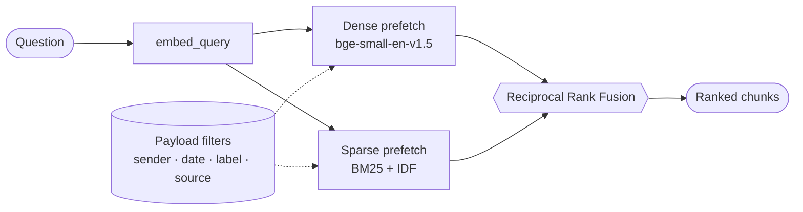
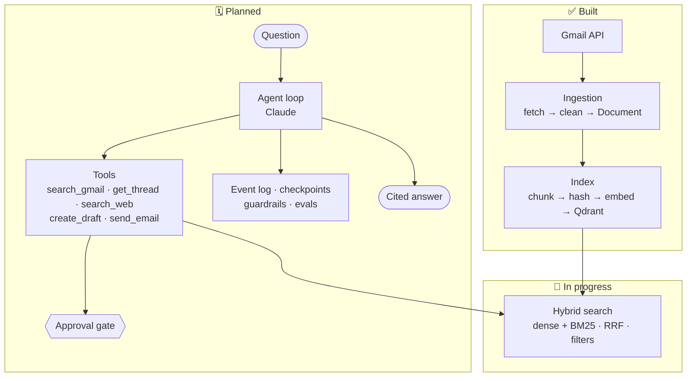

<div align="center">

# Bot


-DC244C)
-5B6EE1)


**A personal executive assistant for Gmail that lives on your machine.**
Index your mailbox into a local hybrid-search index, then (in v1) ask an agent *built from scratch* about your email, with **citations**, and let it **draft or send replies only after you approve**.

</div>

> [!NOTE]
> **Where the project stands (17 Oct 2026).** Gmail ingestion and the hybrid index work end to end, and the hybrid search core is built. The agent, its tools, approvals, guardrails, evals and any UI are **not built yet**. Every section below marks what is ✅ built, 🚧 in progress or 🗓 planned. Nothing planned is presented as finished.

---

## Table of Contents

- [🚀 About](#-about)
- [📊 Status at a Glance](#-status-at-a-glance)
- [🔎 How Hybrid Search Works](#-how-hybrid-search-works)
- [🏗️ Architecture](#️-architecture)
- [🧰 Tech Stack](#-tech-stack)
- [⚡ Setup & First Run](#-setup--first-run)
- [⚙️ Configuration](#️-configuration)
- [🧠 Design Decisions](#-design-decisions)
- [🗺️ Roadmap](#️-roadmap)
- [⚠️ Known Limitations](#️-known-limitations)
- [🔐 Privacy & Security](#-privacy--security)
- [📃 License](#-license)

---

## 🚀 About

**Bot** is a developer-oriented, **local-first** assistant for your inbox. It downloads your Gmail, cleans it, splits it into chunks and stores it in a local [Qdrant](https://qdrant.tech) index that supports both **semantic** and **keyword** search. From v1 phase 3 on, an **agent** will use that index to answer questions about your email and to draft or send replies.

- **Local-first.** Ingestion, embeddings and the vector index all run on your machine. Email content is never sent to a server run by the author.
- **Bring your own keys, $0 to run for the author.** You create your own Google Cloud OAuth client and use your own Anthropic API key. No hosted backend, no Google app verification.
- **The agent is hand-written.** The tool-use loop, tools, harness, guardrails and evals are this project's own code. Claude (via the Anthropic API) is just the language model the agent calls. This is *not* built on an agent framework.
- **Harness, guardrails and evals are the point.** They are the core of the project, not extras, and every design choice is documented with its evidence in [`docs/DECISIONS.md`](docs/DECISIONS.md).
- **Approval before action.** Sending email will always require your explicit approval.

> This is the author's portfolio and learning project. The author writes the code; the reasoning behind it is a feature of the repo.

### What v1 will do 🗓

| # | Job | Example |
|---|-----|---------|
| 1 | **Find that email** | "Find the email about the vendor contract" |
| 2 | **Search by person** | "What did Sam say about the budget?" |
| 3 | **Triage the week** | "What needs my attention this week?" |
| 4 | **Draft and send replies** | Drafts land in your Gmail Drafts, correctly threaded. Sending needs your approval. |
| 5 | **Search the web** | When the answer is not in your mail |

**v1 is Gmail only.** Calendar and Drive are deliberately deferred so the time goes into the harness, guardrails and evals.

---

## 📊 Status at a Glance

| Component | Status |
|---|---|
| Google OAuth, rate limiter, retries | ✅ built |
| Gmail ingestion (fetch, parse, clean) | ✅ built |
| Chunking, embeddings, Qdrant index, de-duplication | ✅ built |
| Hybrid search (dense + BM25, RRF fusion, filters) | 🚧 in progress (phase 2) |
| Sender/name resolution (`recipients.py`) | 🗓 planned |
| Agent loop, Claude client, terminal chat | 🗓 planned (phase 3) |
| Agent tools: `search_gmail`, `get_thread`, `search_web`, `create_draft` | 🗓 planned (phase 3) |
| Event log, checkpoints, approval pause/resume, `send_email` | 🗓 planned (phase 4) |
| Guardrails (permission gate, PII check, grounding check) | 🗓 planned (phase 5) |
| Evals, citation grader, trace viewer | 🗓 planned (phase 5) |

### Measured on the author's own mailbox (last 30 days)

| Metric | Result |
|---|---|
| Emails indexed | **809 / 809** |
| Chunks | **1,658** (avg 2.05 per email) |
| Duplicate chunks | **0** |
| Incomplete emails / empty chunks | **0 / 0** |
| Gmail rate-limit errors during a full ingestion | **0**, at ~96 emails per minute |
| Re-runs | Skip already-indexed emails without re-downloading or re-embedding |

---

## 🔎 How Hybrid Search Works

Neither semantic nor keyword search is enough on its own, and each fails exactly where the other succeeds. These results were **measured**, not assumed:

| Query | Dense (semantic) | BM25 (keyword) |
|---|:---:|:---:|
| "was my meeting rescheduled?" (email says *"move tomorrow's 1:1 to 3pm"*) | ✅ | ❌ no match |
| "did the agreement get signed off?" (email says *"legal approved the vendor contract"*) | ✅ | ❌ no match |
| "invoice INV-20931" among 5 near-identical invoices | ❌ returned INV-20917 | ✅ |

So the search runs both and merges them:



**Filters decide, vectors rank.** Hard constraints (sender, participants, labels, date range, source) are Qdrant payload filters built with a chainable `FilterBuilder`. Relevance comes from the vectors. BM25 cannot replace filters because it only boosts and never excludes, and the sender lives in the headers, not in the chunk text.

---

## 🏗️ Architecture



### Modules

| Path | Role | Status |
|---|---|:---:|
| `assistant/config.py` | Single `.env` loader. Typed values, fails loudly on bad settings, derives the collection name from the embedding model | ✅ |
| `assistant/auth.py` | Google OAuth (desktop flow, PKCE), service builder, `execute()` with a **Gmail token-bucket rate limiter** and exponential-backoff retry | ✅ |
| `assistant/ingest/gmail_ingest.py` | List recent IDs, skip already-indexed, fetch, parse, upsert | ✅ |
| `assistant/ingest/gmail_parse.py` | Pure functions: MIME walk, HTML→text, quote stripping, forward handling | ✅ |
| `assistant/ingest/chunking.py` | Overlapping word-based chunks and content hashing | ✅ |
| `assistant/ingest/embeddings.py` | fastembed dense and sparse embeddings (`embed_documents`, `embed_query`) | ✅ |
| `assistant/ingest/index.py` | Qdrant collection, `upsert_document` with change detection, batched hash lookup | ✅ |
| `assistant/search.py` | `hybrid_search`: dense + sparse prefetch, RRF fusion, dynamic filters | 🚧 |
| `assistant/utils/filters.py` | `FilterBuilder`: senders, participants, labels, date range, source | 🚧 |
| `assistant/model.py`, `loop.py`, `main.py` | Claude client, tool-use loop, terminal chat | 🗓 |
| `assistant/tools/{gmail,web,registry}.py` | Agent tools and their schemas | 🗓 |
| `assistant/store.py`, `context.py` | Event log, checkpoints, approval suspend/resume, token budget and compaction | 🗓 |
| `assistant/guardrails.py` | Permission gate, PII check, grounding check | 🗓 |
| [`docs/DECISIONS.md`](docs/DECISIONS.md) | Every design decision: why, rejected alternatives, evidence | ✅ |
| [`docs/FUNCTIONS.md`](docs/FUNCTIONS.md) | Step-by-step behaviour and contracts of each function | ✅ |

---

## 🧰 Tech Stack

| Piece | Choice | Why |
|---|---|---|
| Language | Python (developed on 3.14) | |
| Vector DB | **Qdrant, local mode** | Payload filters and scroll replace a separate metadata DB. No server to run in v1 |
| Dense embeddings | **`BAAI/bge-small-en-v1.5`** (384-d) | Reads 512 tokens. Replaced `all-MiniLM-L6-v2`, which fastembed truncates at 256 tokens (about 40% of each chunk was ignored) |
| Sparse embeddings | **`Qdrant/bm25`** with IDF modifier | Exact matching for codes, IDs and names. Small (10 MB) and explainable |
| Fusion | **Reciprocal Rank Fusion** | Merges two rankings without tuning weights |
| Embedding runtime | **fastembed (ONNX)** | No PyTorch, so the install stays small |
| Google APIs | `google-api-python-client`, `google-auth-oauthlib` | Official clients |
| HTML cleaning | BeautifulSoup + lxml | |
| Retries | tenacity | Exponential backoff with jitter |
| LLM | Anthropic Claude (`claude-sonnet-5`) | 🗓 from phase 3 |

---

## ⚡ Setup & First Run

> [!IMPORTANT]
> Each user creates **their own** Google Cloud OAuth client. Gmail read access is a Google *restricted* scope, and a single public app would need Google verification plus a paid annual security assessment (roughly $5,000 to $15,000). A per-user client counts as personal use. The trade-off is **10 to 15 minutes of Google Cloud setup**, so this is aimed at technical users.

### 1. Install

```bash
python -m venv venv
source venv/bin/activate          # Windows: venv\Scripts\activate
pip install -r requirements.txt
```

### 2. Create your Google OAuth client

1. In your own Google Cloud project, enable the **Gmail API** (Calendar and Drive APIs are only needed later).
2. Configure the OAuth consent screen in **Testing** mode and add your account as a **test user**.
3. Create an **OAuth client ID** of type **Desktop app**.
4. Download it as `credentials.json` into the project root.

### 3. Configure

Create a `.env` file (see [Configuration](#️-configuration)). Set `ANTHROPIC_API_KEY` too. It is only needed from phase 3.

### 4. Sign in

```bash
python -m assistant.auth
```

A browser consent screen opens and `token.json` is written.

### 5. Ingest your mail

```bash
python -m assistant.ingest.gmail_ingest            # uses INGEST_LOOKBACK_DAYS
python -m assistant.ingest.gmail_ingest --days 7   # a different window
python -m assistant.ingest.gmail_ingest --max 50   # small test run
```

<details>
<summary><b>Setup notes</b></summary>

- Always run modules from the project root with `python -m …`.
- In Google's Testing mode, refresh tokens expire after about 7 days. The app falls back to browser consent automatically.
- The first run downloads the embedding models (about 67 MB dense, plus BM25).
- Scopes requested today: `gmail.messages.readonly`, `gmail.compose`, `gmail.labels`, `calendar.events.owned`, `drive.file`.
- `.env`, `credentials.json`, `token.json`, `data/`, `venv/` and `scratch/` are gitignored.

</details>

The terminal chat (`python -m assistant.main`) is 🗓 planned and does not exist yet.

---

## ⚙️ Configuration

All settings live in `.env` and are read through `assistant/config.py`, which fails loudly on missing or invalid values.

<details open>
<summary><b>Used today</b></summary>

| Variable | Default / note |
|---|---|
| `GOOGLE_CREDENTIALS_PATH`, `GOOGLE_TOKEN_PATH` | Paths to `credentials.json` and `token.json` |
| `GMAIL_SCOPES`, `CALENDAR_SCOPES`, `DRIVE_SCOPES` | OAuth scopes |
| `GMAIL_UNITS_PER_MINUTE` | `4800` |
| `QDRANT_LOCAL_PATH` | `data/qdrant` |
| `QDRANT_COLLECTION_NAME` | Base name. The embedding model is appended automatically |
| `EMBEDDING_PROVIDER` | Must be `fastembed` |
| `EMBEDDING_MODEL`, `EMBEDDING_DIM`, `SPARSE_EMBEDDING_MODEL` | Dense model, its dimension, BM25 model |
| `CHUNK_SIZE_TOKENS`, `CHUNK_OVERLAP_TOKENS` | `400`, `50` |
| `INGEST_LOOKBACK_DAYS` | `30` |

</details>

<details>
<summary><b>Reserved for planned features</b> (read by config, not used yet)</summary>

`ANTHROPIC_API_KEY`, `ANTHROPIC_MODEL`, `TURN_CEILING` (18), `HYBRID_FUSION_METHOD` (rrf), `QDRANT_MODE`, `INGEST_INTERVAL_MINUTES`, `CONTEXT_TOKEN_BUDGET`, `CONTEXT_COMPACT_THRESHOLD`, `EVENT_LOG_PATH`, `MEMORY_FILE_PATH`, `PRESIDIO_ENABLED`, `GROUNDING_CHECK_ENABLED`, `DRIVE_MAX_TEXT_EXTRACT_MB`, `DRIVE_SKIP_MIME_TYPES`, `INDEX_MAX_SIZE_GB`, `INDEX_RETENTION_DAYS`, `APP_ENV`, `USE_TEST_ACCOUNT`.

</details>

### What is stored per chunk

`source`, `external_id` (Gmail message ID), `thread_id`, `title`, `sender`, `participants`, `date`, `chunk_index`, `total_chunks`, `chunk_text`, `content_hash`, plus Gmail labels. Vectors: named `dense` (384-d) and `sparse` (BM25).

---

## 🧠 Design Decisions

The highlights below are summaries. The full reasoning, rejected alternatives and measurements are in **[`docs/DECISIONS.md`](docs/DECISIONS.md)**.

| Decision | Why |
|---|---|
| **Cleaning removes junk, not words** | No stopword removal. "budget was approved" and "budget was **not** approved" stay distinguishable (similarity 0.826) but become identical (1.000) once "not" is dropped. Quoted reply chains are stripped, forwarded content is kept |
| **Chunks of about 400 tokens, 50 overlap** | Measured in words with a 0.75 words-per-token safety ratio. 300 words measured 313 tokens (plain text), 378 (normal work email) and 1,902 (link-heavy email), hence the margin |
| **Each message is indexed separately** | Keeps the right sender and date per chunk, gives accurate citations and avoids re-embedding whole threads on every reply. The full thread is read live via `get_thread` (🗓) |
| **Deterministic point IDs** | `uuid5(namespace, "source:external_id:chunk_index")`, so re-runs overwrite instead of duplicating |
| **Two-level de-duplication** | Skip already-indexed message IDs before fetching (saves API quota), then compare content hashes before embedding (saves compute). Changed items have old chunks deleted by filter, so no stale chunks remain |
| **Model name is part of the collection name** | `exec_assistant_v1__bge-small-en-v1.5`. Changing the model can never silently mix incompatible vectors |
| **No raw email stored** | Only cleaned chunk text, metadata and vectors. Rebuilding means re-fetching from Gmail |
| **Rate limiting measured, not assumed** | Google documents `messages.get` at 20 units, but tests showed a real cost of about 49 to 62 units (refused at 124 gets/min, fine at 97). The limiter counts it as 50. Other costs are documented values × 2.5 and marked *estimated* |

---

## 🗺️ Roadmap

### v1 — target release **10 Nov 2026**

| Phase | Dates | Content | Status |
|:---:|---|---|:---:|
| 1 | Oct 2–10 | Ingestion, chunking, embeddings, index, de-duplication, rate limiter | ✅ done |
| 2 | Oct 11–18 | Hybrid search, `FilterBuilder`, name→address resolution, 5–10 labelled test questions (dense vs sparse vs hybrid) | 🚧 in progress |
| 3 | Oct 19–26 | Claude client, tool-use loop with stop conditions and a labelled turn ceiling, `search_gmail`, `get_thread`, `search_web`, `create_draft`, terminal chat, system prompt | 🗓 |
| 4 | Oct 27–Nov 2 | Event log, checkpoints, approval pause/resume, `send_email` behind the approval gate, context budget and compaction | 🗓 |
| 5 | Nov 3–8 | PII and grounding guardrails, ~20-question eval set, citation grader (Jaccard, pass > 0.7), guardrail tests, trace viewer | 🗓 |
| – | Nov 9–10 | Buffer, README, setup guide, release | 🗓 |

**Non-negotiable in v1:**

- **Harness:** agent loop with stop conditions, token budget and compaction, JSONL event log, checkpoints, pause for approval then resume.
- **Guardrails:** a permission gate (sending always needs approval), a PII check on outgoing text and a grounding check on answers.
- **Evals:** about 20 hand-labelled questions with expected source emails, a citation grader, and guardrail test cases.

### After v1

- **Own MCP servers.** Gmail, Calendar and Drive exposed as this project's own local MCP servers wrapping the tested v1 code, not third-party hosted ones. Those would bring back keyword-only search, lose the measured quota handling and route mail through a third party.
- **Local Qdrant server.** A server on your own machine (for example Docker) so several processes can share the index.
- **More sources.** Calendar, then Drive.
- **Ingestion upgrades.** A 5-minute scheduler, attachment text, Gmail history API for cheaper incremental runs.
- **Retrieval upgrades.** Chunking by real token counts and a SPLADE vs BM25 experiment.
- **Product polish.** A setup wizard, a proper UI, packaging and keychain token storage.

---

## ⚠️ Known Limitations

- Gmail only. Search is still in progress and the agent is not built.
- Google Testing-mode tokens expire about weekly (re-consent opens automatically).
- Quoted text is stripped even when you were added to a thread late and the quote is your only copy (fix planned).
- The `drive.file` scope cannot see existing Drive files, so Drive is deferred.
- Chunk sizes use a words-per-token estimate. Very link-heavy text can still exceed the model's 512-token window.
- Gmail quota costs other than `messages.get` are estimates.
- Local Qdrant allows one process at a time.

---

## 🔐 Privacy & Security

- **Your data stays local.** Email is stored on your machine as cleaned chunks and vectors only. No raw messages or attachments are saved.
- **Two external services only:** Google (the source) and Anthropic (the model, from phase 3, receiving your question plus a few relevant email snippets).
- **Do not host this** or send mail data anywhere else.
- **Secrets are gitignored:** `.env`, `credentials.json`, `token.json`, `data/`.
- **Sending requires explicit approval.** This is a planned guardrail (phase 4), not yet implemented.

---

## 📃 License

**Not decided yet.** `LICENSE` will be added before release.

<div align="center">

<sub>Built to learn, and to show the engineering. · <a href="#">Back to top</a></sub>

</div>
